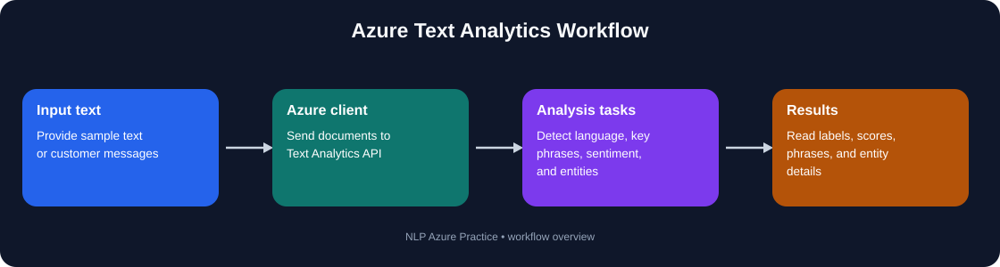
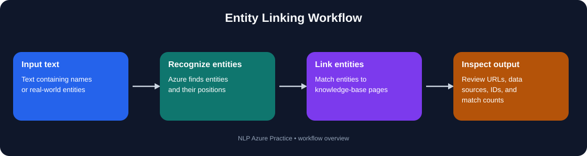
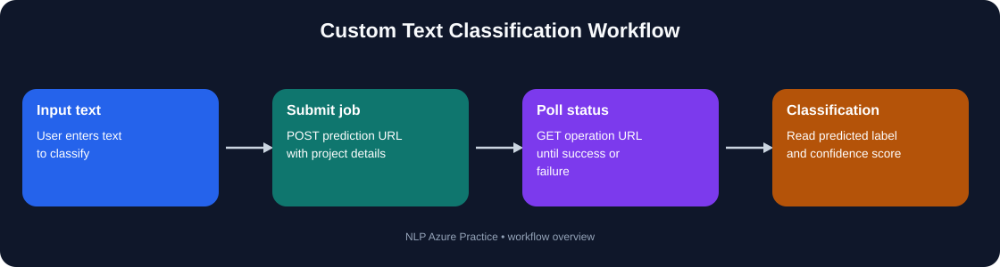
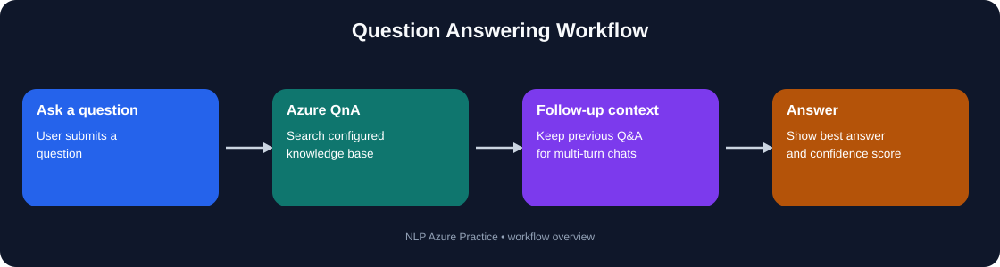

<div align="center">

# NLP Azure Practice

### Python examples for learning Azure AI Language — based on the scripts in this repository


**[Repository](https://github.com/jatinkumar4148/NLP_Azure_Practice) · [Quick start](#-quick-start) · [Scripts](#-what-we-built) · [Flows](#-how-the-code-works)**

</div>

---

## 🧭 What is this repository?

This repository contains small Python practice scripts that call **Microsoft Azure AI Language** services. We used sample text and terminal input to explore how Azure can identify language, extract important phrases, analyze sentiment, recognize entities, link entities to knowledge sources, classify text using a custom model, and answer questions from a configured knowledge base.

These are individual learning scripts—not one combined web application. The results are printed in the terminal. Some examples need an Azure Language resource; custom classification and question answering also need a matching Azure project and deployment.

## 🎯 What we built and learned

| Area | What the provided code does | What we practiced |
|---|---|---|
| Language detection | Sends sample documents in several languages and prints detected language, ISO code, and confidence. | Calling a language API and handling document-level errors. |
| Combined text analysis | Runs language detection, key phrase extraction, sentiment analysis, and categorized entity recognition as analysis actions. | Running multiple text-analysis tasks over sample text and reading each action result. |
| Key phrase extraction | Sends sample customer messages and prints extracted phrases. | Finding the main ideas in short text. |
| Sentiment analysis | Prints overall sentiment, confidence scores, and sentence-level sentiment. | Interpreting positive, neutral, and negative outputs. |
| Entity recognition | Identifies entities and prints category, optional subcategory, confidence, offsets, and lengths. | Understanding structured information extracted from text. |
| Entity linking | Prints recognized entity names, URLs, data sources, and text matches; one version builds a JSON-like result. | Connecting a text mention to a linked entity and handling errors. |
| Custom text classification | Submits a custom multi-label classification job, polls its operation URL, and prints returned labels with confidence scores. | Working with an asynchronous REST job and project/deployment settings. |
| Question answering | Queries a configured knowledge base and selects the answer with the highest confidence. | Using a question-answering client and confidence threshold. |
| Multi-turn Q&A | Carries previous question/answer context and displays follow-up prompts when available. | Passing conversational context between turns. |
| Active learning / feedback | Uses authoring API calls to add alternate questions; the feedback version asks whether the answer was helpful. | Exploring a feedback-driven knowledge-base update workflow. |

## 🖼️ How the code works

### 1. Text Analytics flow



The combined-analysis script uses Azure's analysis actions for language detection, key phrase extraction, sentiment analysis, and categorized entity recognition. Separate scripts demonstrate these features individually.

### 2. Entity linking flow



The entity-linking examples inspect entity names, external URLs/data sources, and matches in the input text. The exception-handling version also builds and prints structured JSON-like output.

### 3. Custom text classification flow



`Custom_Text_Classification.py` submits text to the configured custom multi-label classification endpoint, reads the `operation-location` response header, polls until the job succeeds or fails, and prints the returned labels and confidence scores.

### 4. Question-answering flow



The Q&A scripts select the highest-confidence answer. The multi-turn version can pass previous-question context and show follow-up prompts. The active-learning versions include authoring calls that can add alternate questions to the configured project.

## 🗂️ What we built

<details>
<summary><strong>🌍 Language detection and combined analysis</strong></summary>

| File | What happens in the code |
|---|---|
| `Detect language.py` | Creates a `TextAnalyticsClient`, submits example text in English, Chinese, French, and Spanish, then prints the detected language and ISO code. |
| `Detect_language2.py` | Uses `DetectLanguageInput` with realistic examples, country hints, and per-document error handling. |
| `Detect_Lang+Extract_KeyPhrase+Extract_Entities+Senti,mental_Analysis.py` | Runs four analysis actions and prints language, key phrases, sentiment scores/sentence details, and categorized entities. |

</details>

<details>
<summary><strong>🔑 Key phrases, sentiment, and entities</strong></summary>

| File | What happens in the code |
|---|---|
| `Extract_key_phrases.py` | Sends sample customer messages to `extract_key_phrases` and prints the phrases per document. |
| `Sentimental_Analysis.py` | Calls `analyze_sentiment`, then prints document-level sentiment scores and sentence-level breakdowns. |
| `Extract_Entities.py` | Calls `recognize_entities` and prints entity text, category, optional subcategory, confidence, offsets, lengths, and available knowledge-base metadata. |

</details>

<details>
<summary><strong>🔗 Entity linking</strong></summary>

| File | What happens in the code |
|---|---|
| `Entity_Linking.py` | Defines `link_entities(text)` and prints linked entity names, URLs, data sources, and match counts/offsets. |
| `Extract_Linked_Entity.py` | Demonstrates `recognize_linked_entities` with sample text and prints each entity and its matches. |
| `Extract_Linked_Entity_ExceptionHandling.py` | Adds client/API exception handling and constructs a structured result containing documents, entities, matches, and errors. |

</details>

<details>
<summary><strong>🎯 Custom text classification</strong></summary>

| File | What happens in the code |
|---|---|
| `Custom_Text_Classification.py` | Accepts text from the terminal, submits a `CustomMultiLabelClassification` job, polls job status, and prints returned categories and confidence scores. |

The script expects the prediction URL, Azure key, project name, and deployment name to match the Azure configuration. The code uses a job-based REST API flow; it is not a locally trained classifier.

</details>

<details>
<summary><strong>❓ Question answering, multi-turn context, and feedback</strong></summary>

| File | What happens in the code |
|---|---|
| `Question_Answering_normal.py` | Asks for terminal input, queries the configured Q&A project, and prints the highest-confidence answer. |
| `Question_Answering_By_Multiturn.py` | Keeps previous Q&A context and offers follow-up prompts returned by the service. |
| `Question_Answering_Active_Learning_synonyms.py` | Includes functions to list Q&As and add an alternate question through the authoring API, along with multi-turn question answering. |
| `Question_Answering_Active_Learning_synonyms_FEEDBACK.py` | Adds a helpful/not-helpful feedback prompt and can add the user's question as an alternate question when feedback is positive. |

The active-learning scripts can modify a knowledge base. Test them against a development project first.

</details>

## 🚀 Quick start

### 1. Clone the repository

```powershell
git clone https://github.com/jatinkumar4148/NLP_Azure_Practice.git
cd NLP_Azure_Practice
```

### 2. Create a virtual environment

**Windows PowerShell**

```powershell
python -m venv venv
.\venv\Scripts\Activate.ps1
```

If script activation is blocked in PowerShell, allow it for the current terminal session only:

```powershell
Set-ExecutionPolicy -Scope Process -ExecutionPolicy RemoteSigned
.\venv\Scripts\Activate.ps1
```

### 3. Install the packages used by these examples

```powershell
python -m pip install --upgrade pip
python -m pip install azure-ai-textanalytics azure-ai-language-questionanswering azure-core requests python-dotenv
```

### 4. Configure credentials locally

Create a `.env` file in the repository root, using your own Azure resource values:

```dotenv
LANGUAGE_ENDPOINT=https://YOUR-RESOURCE.cognitiveservices.azure.com/
LANGUAGE_KEY=YOUR_AZURE_LANGUAGE_KEY
```

For scripts that read `.env`, install `python-dotenv` and call `load_dotenv()` before reading `os.getenv(...)`. Some provided scripts use their own names such as `ENDPOINT`, `KEY`, or `API_KEY`; update those configuration lines to read environment variables before running them.

**Do not commit `.env` or paste real keys into source code.** Keep `.env` and `venv/` in `.gitignore`.

### 5. Run a script

```powershell
python "Detect language.py"
python Extract_key_phrases.py
python Sentimental_Analysis.py
python Extract_Entities.py
python Entity_Linking.py
python Question_Answering_normal.py
```

Run from the repository root. Files with spaces in their names need quotes in PowerShell.

## 🧰 Requirements and Azure setup

- Python and an activated virtual environment.
- An Azure AI Language resource with a valid endpoint and key.
- For custom classification: a matching custom classification project/deployment and prediction URL.
- For question answering: a configured question-answering project and deployment.
- For active-learning examples: authoring access to the configured project.

The examples use Azure SDK methods and, in the custom classification / authoring cases, REST API calls. API versions and available operations depend on the Azure service configuration; check them if an endpoint returns an unsupported-version or operation error.

## 🧯 Troubleshooting

<details>
<summary><strong>401 / 403 authentication error</strong></summary>

Confirm that the endpoint and key belong to the same resource, the key is valid, and your script actually loads the environment variables.

</details>

<details>
<summary><strong>Project or deployment not found</strong></summary>

Check the configured project name, deployment name, endpoint, and whether the project has been deployed in Azure.

</details>

<details>
<summary><strong>Import error</strong></summary>

Activate the intended virtual environment and install the package that provides the missing module.

</details>

<details>
<summary><strong>Some documents return an error</strong></summary>

Several scripts handle multiple documents. Inspect each result's `is_error` value and error details; one document can fail even if others succeed.

</details>

## 📚 What we learned

- How Python scripts authenticate to Azure AI Language.
- How to send sample text and lists of documents to language APIs.
- How to read sentiment labels, confidence scores, key phrases, and entity metadata.
- How asynchronous custom classification jobs are submitted and polled.
- How a Q&A project returns answers and follow-up prompts.
- How previous-question context and feedback can be used in an authoring workflow.
- Why API keys should be kept outside source code and Git history.

## 🔒 Security notes

- Keep `.env` out of Git and never include Azure keys in source files.
- If a key was ever committed, rotate it if it is still valid and remove secret-containing commits from the branch before pushing.
- Do not bypass GitHub secret scanning to publish a credential.
- Use a development Q&A project when testing scripts that modify questions.

## 🧭 Suggested next steps

- Add a `requirements.txt` with tested versions.
- Standardize credential loading across all scripts.
- Add sample expected outputs and tests.
- Group examples into folders by feature.
- Add screenshots of sample terminal outputs, using synthetic text and no secrets.

## 📄 License

No license is specified in the provided project files. Add a license if you want to define how others may reuse this code.

---

<div align="center">

**A practical learning repository for Azure AI Language and Python.**

[Back to top](#nlp-azure-practice)

</div>
